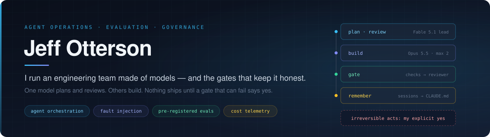
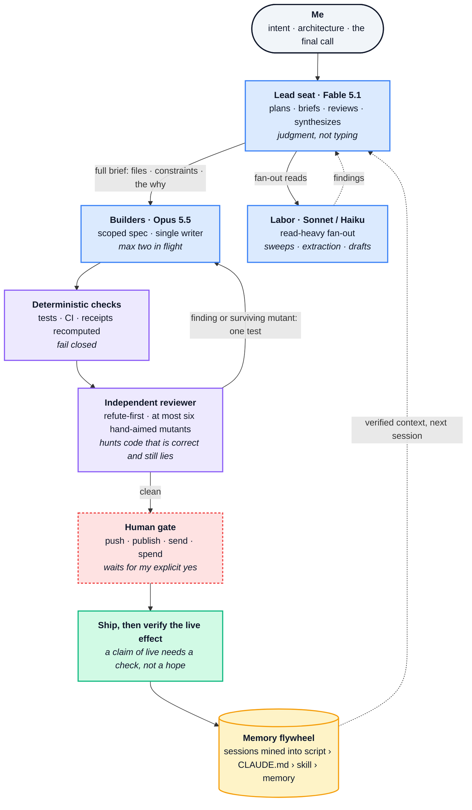

  

  
  
  

---

I run a small engineering team where every engineer is a model. One frontier model holds the lead
seat: it plans, briefs, and reviews, and it doesn't do the typing. Scoped builders write the code.
Cheaper models do the reading. Nothing ships until a deterministic check and an independent
reviewer both pass, and nothing irreversible happens without my explicit yes.

Then I measure what agents like these get wrong, and publish it, including the nulls.

## How I work

**Seats.** The lead seat is for judgment: plans, architecture calls, briefs, adversarial review,
synthesis. Builds go to Opus 5.5 workers, briefed once and completely (files, constraints,
acceptance criteria, and *why*) so there is no launch-wait-rebrief loop. Sweeps and drafts go to the
cheapest model that can do them. The lead reviews every worker's output before anything is called done.

**Gates.** Machine checks run first and fail closed. Then a separate reviewer agent tries to refute
the change. It ranks findings by *"if this is wrong, how would we find out?"* and aims a handful of
hand-built mutants at the claims a user acts on: the printed number, the refusal, the label. A
surviving mutant gets exactly one new test. High-stakes claims get a different-lineage model as
the reviewer.

**Memory.** Each session's corrections are mined and routed into the most durable place that will
hold them: a script before a CLAUDE.md line, a CLAUDE.md line before a skill, a skill before a
memory note. Active repos carry a verified context map (CLAUDE.md, or AGENTS.md on the Cursor-run
repos), and a zero-token sentinel flags any that drift. State changes are written down in the
session they happen in, not batched for later.

**Enforced, not remembered.** The rules live in the harness as hooks, most of them built from a
mine of 415 of my own sessions:

| Hook | What it does |
|---|---|
| `seat-guard` | Denies a general-purpose subagent launched without a pinned model, and a third concurrent Opus agent |
| `verify-live` | Blocks a "deployed / live" claim when no curl, browser, or simulator check followed the deploy |
| `gauges` | Context, 5-hour, and weekly budget in the status line, with alerts at thresholds |
| `wiki-log` | After milestone work, logs it to the right knowledge vault in that vault's own conventions |

On the portfolio repos, cloud agents in Cursor open PRs under each repo's `AGENTS.md` and a
`BUGBOT.md` review policy. On most of them a CI job recomputes the published numbers from raw run
files before merge, and I merge every PR by hand. [agent-gate](https://github.com/Jott2121/agent-gate)
is the reference repo.

## Every rule has a receipt

None of the gates above are taste. Each one has a public measurement behind it. Some of those
measurements put the rule there; the rest were run to see whether the rule deserved to stay.

| Rule in the loop | Receipt | Measured in |
|---|---|---|
| The reviewer leads with the specific break and how you'd notice it, not a verdict | Requiring reviewers to quote what they saw before ruling took planted-fault detection from **16.7% to 55.0%** on 825 paired cells | [sabot](https://github.com/Jott2121/sabot) |
| Verify the side effect, not the report | A write tool that reported success and wrote nothing was flagged **0 of 119** times, on all three frameworks | [sabot](https://github.com/Jott2121/sabot) |
| Irreversible acts wait for a human | Agents flagged real data conflicts **97–99%** of the time, then refused or escalated **0–2%** | [tripwire](https://github.com/Jott2121/tripwire) |
| Diverse reviewers, never copies of one | Three identical LLM judges are worth **1.31** independent votes; diverse panels **2.3–2.4** | [quorum-cal](https://github.com/Jott2121/quorum-cal) |
| Mutants, not coverage | A green suite at **97% coverage** let **25 of 71** injected defects through | [crucible](https://github.com/Jott2121/crucible) |
| A verified context map in every active repo | Mapped arm won **6/6**: median tokens **−68%**, median turns **−71%** | [claude-md-ab](https://github.com/Jott2121/claude-md-ab) |
| Cheap labor, premium judge, metered | Routing four mechanical stages to a cheap model cut one run **67%** with identical output. The same meter overturned my own plan: the whale was the verify step, not fetch | [agent-cost-attribution](https://github.com/Jott2121/agent-cost-attribution) |
| Cross-lineage review on published claims | An outside-lineage review caught a confound in crucible's paper draft, and forced quorum-cal's v1.0.1 corrections one day after release | [crucible](https://github.com/Jott2121/crucible) · [quorum-cal](https://github.com/Jott2121/quorum-cal) |

## Research

All pre-registered before the first scored run. Scored by code where possible, never by the model
being tested. Negative results run at the same prominence as positive ones.

### [tripwire](https://github.com/Jott2121/tripwire) — *do AI agents act on data they know is wrong?*
Tool-using agents get engineering data that is wrong: **200 real FAA Service Difficulty Reports**
checked against the FAA aircraft registry. grok-4.7 and Muse Spark Open saw the conflict and answered
anyway. A one-sentence "check your data" prompt moved grok-4.7 to **84% correct, at 21% false alarms**
on clean records; Muse Spark Open went from 0% to 3%. Honest part: two models, one run per item, and
most of the mismatches are serial numbers.

`800 scored runs · $7.86 · no LLM judge`

### [sabot](https://github.com/Jott2121/sabot) — *do your pipeline's own reviewers catch planted faults?*
Controlled faults planted inside running LangGraph, CrewAI, and AutoGen/Magentic-One pipelines, with
reviewer instructions byte-identical across all three. Faults in the text get noticed; faults in the
process mostly don't. And noticing isn't acting: a wrong tool value was flagged in **92.4%** of cells
and corrected in only **40.3%**. Honest part: one pipeline model, and the results describe this
reviewer design. They don't rank the frameworks.

`825 paired cells · spec registered publicly before any scored run · DOI 10.5281/zenodo.21539796`

### [quorum-cal](https://github.com/Jott2121/quorum-cal) — *how many votes is your judge panel actually worth?*
Gold sets whose labels are true by construction (mutants the subject's own tests kill, and the fixes
that provably revert them), judged by sandboxed CLI judges across three model lineages. Diverse panels
shared **0 false endorsements across 99 bugs**. Honest part: the first cross-lineage number was a
flashy 3.00 that dissolved under a larger sample. The culprit was gold-set label noise, and the
writeup tells all four acts.

`180 tasks · ~2,000 judge calls · 132 tests · CUSUM drift monitor`

### [crucible](https://github.com/Jott2121/crucible) — *your AI wrote the tests. Who tested the tests?*
A Tester/Critic loop that kills **24 of the 25** survivors on that 97%-coverage suite. It throws out
critic tests that fail on pristine code rather than bank a kill it hadn't earned, and it reports the
one mutant still standing. In a frozen-baseline experiment the critic rounds killed a mean **78%** of
the survivors left standing (95% CI 0.59–0.94). The cross-lineage critic did not beat the
same-lineage one, and that null sits next to the positive result. Honest part: an earlier "huge"
cross-lineage effect was silent output truncation. That autopsy, and the fail-closed instrumentation
built from it, is the real finding.

`462 tests · 99% mutation score on its own code · $0 metered on a Claude subscription`

### [claude-md-ab](https://github.com/Jott2121/claude-md-ab) — *what a verified CLAUDE.md is worth to an agent*
Same agent, same six repos, with and without a verified context map, against ~190 tokens of map.
Protocol and decision rule committed before any run, because I wanted the mapped arm to win and
pre-registration is the defense. Honest part: **n=6, one run per cell**, and the README says so first.

## Infrastructure

| Repo | What it is |
|---|---|
| [agent-gate](https://github.com/Jott2121/agent-gate) | Fail-closed quality gate as an MCP server (`pip install mcp-agent-gate`). Every run writes a hash-chained, tamper-evident receipt. |
| [oracle-gate](https://github.com/Jott2121/oracle-gate) | A framework for testing AI-built code. Coverage isn't fault detection, and the gap widens when one model writes both the code and its tests. |
| [graph-guard](https://github.com/Jott2121/graph-guard) | Typed knowledge graph + multi-hop retrieval. On a real 586-note corpus scored against 83 real sessions, the graph did not beat chunk-level TF-IDF, and neither did the ontology. The README leads with that null and keeps the original +26% MRR benchmark as the lesson: it was built from the mechanism under test. |
| [rag-guard](https://github.com/Jott2121/rag-guard) | RAG that refuses when it can't ground the answer. Groundedness check, PII redaction, an eval that names its misses (refusal accuracy 0.90). |
| [agent-cost-attribution](https://github.com/Jott2121/agent-cost-attribution) | Per-stage token/$ waterfall, plus a detector for runs that report success while silently broken. |
| [bow](https://github.com/Jott2121/bow) | My always-on, phone-reachable agent daemon: scheduled routines and a self-healing watchdog. Still running. It no longer leads; orchestration moved into the seat model above. |
| [fleet-mode](https://github.com/Jott2121/fleet-mode) | The first version of this doctrine, kept public: adding agents has a negative average payoff on most tasks, so fan out only for reads and keep one writer. |

<b>What I retired, and why</b>

 

Changing the process when the evidence says so is part of the process.

| Retired | Why |
|---|---|
| **Bow as the center of everything** | The unit I optimize is cost to an accepted deliverable, my attention included. Steering each call from an interactive lead seat keeps the build, review, catch, fix loop visible and short. Bow kept the always-on jobs: routines and the phone relay. |
| **Mutation batteries of twenty** | On a real build wave, the first five or six hand-aimed mutants found every survivor (four real test gaps, one in a suite that was fully green). The next fifteen only confirmed kills. Now: six, aimed at the claims a user acts on. |
| **crucible as a standing gate** | On that same wave it was never invoked; the reviewer's hand-built mutants found all four gaps. It stays a published tool and research result; I no longer run it by default. |
| **Auto-rendered visual plans and recaps** | I wasn't reading them, and the rendered output came back into context as token cost every turn. Plain prose now. |
| **Unpinned subagents** | Subagents inherit the lead's model by default, which spent frontier-model budget on scoped work for no quality gain. Now every build launch names its model, and a hook denies the ones that don't. |

<b>Applied ML &amp; analytics</b> — SHAP-explained classifiers, regression audits, live demos

 

| Project | What it does | Live |
|---|---|---|
| [attrition-risk-ml](https://github.com/Jott2121/attrition-risk-ml) | Three models benchmarked under 5-fold stratified CV. The well-specified linear model wins at this sample size, and the writeup says why. Per-prediction SHAP attributions. | [demo](https://hr-attrition-predictor-jotterson.streamlit.app/) |
| [funnel-disparity-stats](https://github.com/Jott2121/funnel-disparity-stats) | Two-proportion z-test and 4/5ths-rule screening, flagging funnel stages where pass-rate gaps cross significance. | [demo](https://hiring-funnel-analytics-jotterson.streamlit.app/) |
| [workforce-planning-demand-forecast](https://github.com/Jott2121/workforce-planning-demand-forecast) | Capacity modeling, attrition-adjusted supply, time-to-fill simulation. | [demo](https://workforce-planning-jotterson.streamlit.app/) |
| [pay-equity-regression](https://github.com/Jott2121/pay-equity-regression) | Controlled OLS with residual drilldown and budget-aware remediation scenarios. | — |
| [ai-career-threat-index](https://github.com/Jott2121/ai-career-threat-index) | Open dataset: AI displacement risk across 300 professions, four published sub-scores, quarterly review. | — |

## The bar I hold my own repos to

| Gate | What it means |
|---|---|
| **CI on every push** | Multi-version matrices where they earn it: 3.11–3.13 across the agent core, 3.9–3.12 on agent-cost-attribution. |
| **Receipts recomputed** | On most portfolio repos, a CI job re-derives the published numbers from the raw run files before merge. |
| **Coverage-gated builds** | On most code repos the build **fails** below a coverage floor, so the suite can't quietly rot. |
| **Mutation-tested** | crucible's own score is published from CI to the live badge above; survivors are triaged and documented. |
| **CodeQL** | `security-extended` queries on push, PR, and weekly across the code repos. tripwire is next. |
| **Pinned supply chain** | GitHub Actions pinned to commit SHAs (one publish workflow still on tags). Dependabot on. |
| **Protected `main`** | On the infrastructure repos, nothing merges until checks pass. The newer research repos are next. |

Every badge on this page is backed by a gate that runs and can fail. That's the difference between
a receipt and a claim.

## Background

Twelve years in talent and workforce analytics, then a move into AI. USMC infantry veteran.
Everything on this profile is personal work, built on my own time and equipment.

I came to AI as an operator, not an ML engineer, and I build accordingly: I own the architecture, the
evals, and the gates, and I direct models to do the typing. The applied ML and statistics here are
mine (SHAP-explained classifiers, regression audits, two-proportion z-tests, pre-registered
experiments), built against real constraints, not on a whiteboard.

 

  <a href="https://www.linkedin.com/in/jeff-otterson/">LinkedIn</a>
  &nbsp;·&nbsp;
  <a href="https://github.com/Jott2121?tab=repositories">All repositories</a>

<i>Receipts, not claims.</i>

